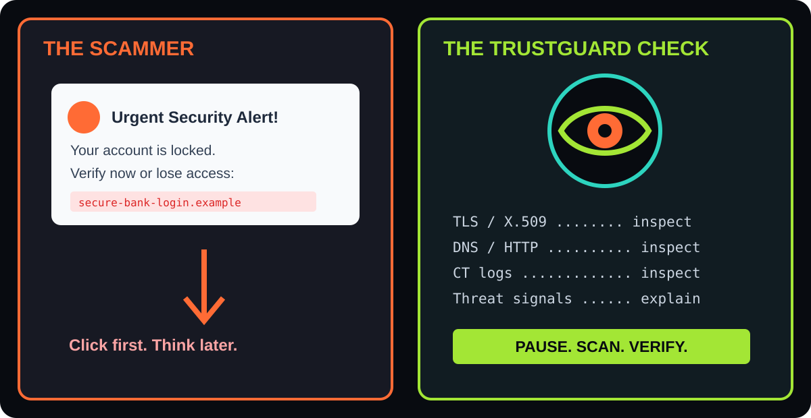

# TrustGuard AI

TrustGuard AI is a full-stack digital trust intelligence workstation for
defensive website investigation. It combines live TLS and certificate
inspection, DNS and HTTP security checks, Certificate Transparency lookups,
heuristic risk scoring, and optional Gemini threat synthesis in a focused
security-operations interface.

The application has two primary entry points:

- `/` — welcome and access-selection page.
- `/dashboard` — guest-capable investigation dashboard.

> **Scope:** TrustGuard AI is designed for authorized, defensive analysis.
> Only scan domains you own or have permission to investigate. The scanner uses
> public DNS/HTTPS/TLS interfaces; it is not an exploitation framework.




## How phishing links work

Phishing is a social-engineering attack: the message creates urgency, imitates
a trusted brand, and sends the victim to a lookalike website. The page may use
a familiar logo and a convincing login form, but the attacker controls the
domain and collects passwords, payment details, one-time codes, or recovery
information.

The usual chain looks like this:

1. **Delivery:** a fake bank, delivery, workplace, or support message arrives
   by email, SMS, social media, or chat.
2. **Pressure:** the message claims an account is locked, a payment failed, or
   an urgent verification is required.
3. **Deception:** a shortened or lookalike URL leads to a cloned login page.
4. **Capture:** submitted credentials or financial information are sent to the
   attacker, who may reuse them immediately.
5. **Consequence:** the victim can lose account access, money, identity data,
   or control of other accounts through password reuse.

### How a phishing link becomes a money scam

The link itself is usually only the first step. The financial loss happens
when the fake page or an impersonating support agent uses the captured
information to move money:

1. **Credential harvest:** the victim enters an email address, password, card
   number, PIN, or one-time passcode into the cloned page.
2. **Account takeover:** the scammer signs in to the real banking, shopping,
   wallet, or email account. Email access can let them reset other passwords.
3. **Payment manipulation:** the attacker may add a new beneficiary, change a
   saved payout account, place fraudulent orders, or transfer funds.
4. **Social-engineering escalation:** the scammer calls or messages while
   pretending to be bank support and asks for an OTP, remote-access session,
   “refund” approval, or a second transfer.
5. **Loss and delay:** transfers can be difficult to reverse, and the victim
   may not notice until alerts, statements, or account lockouts appear.

Common warning signs include an unexpected urgent message, a domain with
extra words or misspellings, a shortened URL, a login page reached from a
message instead of a bookmark, requests for OTPs or recovery codes, and
instructions to move money to a “safe” account. Banks and legitimate support
teams do not need your password or one-time code.

### How TrustGuard AI helps

TrustGuard AI gives a user a place to investigate a suspicious destination
**before entering credentials**. For an authorized target, it can:


- inspect the TLS handshake and X.509 certificate identity;
- compare hostname, certificate subject, SANs, issuer, validity, and key
  posture;
- review HTTP security headers, redirects, and DNS records;
- check Certificate Transparency data for certificate and issuance clues;
- apply eMudhra weak-key diagnostics and threat heuristics;
- produce a risk score, evidence summary, attack-vector classification, and
  remediation guidance;
- scan multiple candidate URLs without opening each one manually.

TrustGuard AI does not guarantee that a site is safe and cannot replace
browser protections, password managers, MFA, or human judgment. A valid
certificate only proves encrypted transport; it does not prove that the
website is honest. Never submit credentials to a suspicious page, even when
an audit returns a low risk score.

If you already clicked a suspicious link, close the page, contact the
organization through its official website or phone number, change reused
passwords from a clean device, revoke unknown sessions, enable MFA, and
contact your bank immediately if payment details or transfers were involved.

## Highlights

- **Live TLS audit** using a server-side Node.js TLS socket on port 443.
- **X.509 inspection** including subject, SANs, issuer, validity, protocol,
  cipher, key algorithm, and key size.
- **Certificate Transparency** lookup through `crt.sh`.
- **eMudhra weak-key heuristics** and certificate trust diagnostics.
- **HTTP security-header assessment** for HTTPS responses and redirects.
- **DNS posture checks** for address, MX, SPF, and DMARC records.
- **Gemini 3.8 Flash analysis** when `GEMINI_API_KEY` is configured, with a
  deterministic heuristic fallback when it is not.
- **Threat scoring** with risk levels, evidence, attack-vector classification,
  and remediation guidance.
- **Bulk scanning** for up to 12 targets with concurrent processing,
  filtering, sorting, CSV export, and SOC-friendly summaries.
- **Trust-score trend surveillance** with certificate-maintenance lapse
  indicators.
- **PDF, PNG, clipboard, and Web Share report workflows.**
- **Community threat feed** with read access for guests. Write and vote
  endpoints remain server-denied until authenticated identity tokens are
  verified server-side.
- **Browser extension guide** with generated integration snippets and the
  `/api/scan` contract.
- **Responsive cyber-operations UI** with the TrustGuard Cyber Eye logo,
  keyboard-friendly controls, and Radix-based primitives.

## Technology Stack

### Application

- **React 19** — component-based UI.
- **TanStack Start** — SSR/full-stack application runtime.
- **TanStack Router** — file-based routing and route metadata.
- **TanStack Query** — client-side query/cache integration.
- **TypeScript** — strict application typing.
- **Vite 8** — development server and production bundling.
- **Nitro** — deployment/runtime output generated by the TanStack/Lovable
  configuration.

### Styling and UI

- **Tailwind CSS v4** — utility styling and design tokens.
- **Radix UI** — accessible headless primitives.
- **Lucide React** — interface icons.
- **class-variance-authority**, **clsx**, and **tailwind-merge** — composable
  class handling.
- **Recharts** — trust-score visualization.

### Security and data integrations

- **Node.js `tls`** — raw TLS socket and peer certificate inspection.
- **Node.js `dns`** — DNS, MX, SPF, and DMARC checks.
- **Node.js `crypto` / certificate parsing** — cryptographic diagnostics.
- **`crt.sh`** — public Certificate Transparency search.
- **Firebase Authentication** — optional Google sign-in.
- **Firebase Firestore SDK** — client initialization is available for Firebase
  project integration; the current threat feed uses an in-memory server store.
- **Google Gemini via `@google/genai`** — optional AI threat synthesis.

### Reports and testing

- **jsPDF** — downloadable PDF audit reports.
- **HTML canvas APIs** — PNG report cards.
- **Vitest** — unit and component test runner.
- **Testing Library + jsdom** — React interaction and DOM testing.
- **ESLint + Prettier** — linting and formatting.

## How the application works

1. A user opens `/` and chooses Google sign-in or guest access.
2. The dashboard submits a target to `POST /api/scan`.
3. The server normalizes the target, opens a TLS connection, and collects
   certificate, HTTP, DNS, and CT data.
4. Gemini analyzes the collected evidence when an API key is available.
5. The fallback scorer produces a result when Gemini is unavailable.
6. The dashboard presents the evidence, score, trends, and remediation steps.
7. Users can run bulk scans and export/share the resulting reports.

Guest mode is a product-level restriction, not a security boundary. Community
write operations are explicitly rejected by the server until Firebase identity
token verification is implemented.

## Repository layout

```text
.
├── public/
│   ├── favicon.svg                 # TrustGuard Cyber Eye browser icon
│   └── robots.txt
├── src/
│   ├── components/
│   │   ├── BrowserExtensionGuide.tsx
│   │   ├── BulkUrlScanner.tsx
│   │   ├── CommunityThreatFeed.tsx
│   │   ├── ShareReportModal.tsx
│   │   ├── TrustScoreTrendChart.tsx
│   │   └── ui/                    # Radix/Tailwind UI primitives
│   ├── hooks/
│   │   └── use-auth.tsx           # Guest and Firebase auth state
│   ├── lib/
│   │   ├── firebase.ts            # Browser Firebase initialization
│   │   ├── report-generator.ts    # PDF and PNG report generation
│   │   ├── scan.ts                # URL normalization and scan steps
│   │   └── utils.ts
│   ├── routes/
│   │   ├── __root.tsx             # App shell, SEO, favicon, providers
│   │   ├── index.tsx              # Welcome/access page (/)
│   │   └── dashboard.tsx          # Investigation dashboard (/dashboard)
│   ├── server/
│   │   ├── scanner.ts             # TLS, HTTP, DNS, CT, and AI analysis
│   │   └── threat-store.ts        # In-memory threat feed store
│   ├── server.ts                   # API routing and SSR entry wrapper
│   ├── styles.css
│   └── test/
├── firebase-applet-config.json     # Public Firebase web configuration
├── firebase-blueprint.json
├── firestore.rules
├── package.json
├── tsconfig.json
├── vite.config.ts
└── vitest.config.ts
```

`src/routeTree.gen.ts` is generated by TanStack Router. Do not edit it
manually.

## Requirements

- Node.js 20 or newer (Node.js LTS recommended).
- npm 10 or newer.
- Network access for live DNS, HTTPS/TLS, and `crt.sh` checks.
- A Gemini API key only if live Gemini synthesis is desired.
- Firebase configuration only if Google sign-in and Firebase-backed features
  are enabled for the deployment.

## Local setup

### 1. Clone and install

```bash
git clone <repository-url>
cd archive-to-app
npm install
```

### 2. Configure optional secrets

Create `.env` from `.env.example`:

```bash
copy .env.example .env
```

Set the server-side Gemini key:

```dotenv
GEMINI_API_KEY=your_gemini_api_key
```

Do not commit `.env` or any secret value. The Gemini key is read by the
server-side scanner and must never be exposed in browser code.

The repository includes Firebase web configuration for the client. Before
using Google sign-in in another Firebase project, update the Firebase
configuration and authorized domains through Firebase rather than hard-coding
secrets in the application.

### 3. Start development

```bash
npm run dev
```

Open [http://localhost:3000](http://localhost:3000).

The dev command binds Vite to `0.0.0.0:3000`, which also makes the app
reachable from supported local-network and container environments.

## Scripts

| Command | Purpose |
| --- | --- |
| `npm run dev` | Start Vite development mode on port 3000 |
| `npm run build` | Create the production client, SSR, and Nitro output |
| `npm run build:dev` | Create a development-mode production build |
| `npm run preview` | Preview a Vite production build |
| `npm test` | Run the Vitest suite once |
| `npm run test:watch` | Run Vitest in watch mode |
| `npm run lint` | Run ESLint across the repository |
| `npm run format` | Format repository files with Prettier |

## API reference

The application server exposes these routes:

### `GET /api/ping`

Health check:

```json
{ "pong": true }
```

### `POST /api/scan`

Request:

```json
{ "targetUrl": "https://example.com" }
```

Returns a complete scan result containing certificate, HTTP header, DNS, CT,
eMudhra, and AI/heuristic analysis data.

### `POST /api/bulk-scan`

Request:

```json
{
  "urls": [
    "https://example.com",
    "https://example.org"
  ]
}
```

The server trims the list to 12 targets and returns per-target success or
error results.

### `GET /api/threats`

Returns the current threat-feed records from the server-side store.

### `POST /api/threats` and `POST /api/threats/vote`

These endpoints currently return `403`. Server-side Firebase token validation
must be added before enabling community writes or votes.

## Testing and quality checks

Run the targeted test suite:

```bash
npm test
```

Before opening a pull request, run:

```bash
npm run lint
npm test
npm run build
```

Tests cover URL normalization, threat-store behavior, routing, scanning
components, bulk scan interactions, community feed behavior, report modals,
extension guidance, and trust-score charts.

## Production deployment

### Build output

Create the production output:

```bash
npm run build
```

The build produces:

- `.output/public` — browser assets.
- `.output/server` — Nitro server bundle.
- `.output/nitro.json` and deployment metadata.

Do not commit generated `.output` or `.wrangler` directories.

### Nitro/Cloudflare deployment

The repository's Vite configuration uses the TanStack/Lovable preset with a
Cloudflare-compatible Nitro target. After building, deploy the prebuilt
output with the Nitro command appropriate for the configured Cloudflare
account:

```bash
npx nitro deploy --prebuilt
```

Configure `GEMINI_API_KEY` as a server secret in the deployment platform.
Also configure Firebase authorized domains for the deployed hostname.

### Vercel deployment

For Vercel, import the repository and configure the project from the
repository root. Use the repository's build command:

```bash
npm run build
```

Set `GEMINI_API_KEY` in Vercel Project Settings → Environment Variables, and
redeploy after changing it. Verify the generated deployment supports the
TanStack Start/Nitro server output and that `/api/ping`, `/api/scan`, and
`/dashboard` work on the deployed hostname. Add that hostname to Firebase
Authentication authorized domains if Google sign-in is enabled.

The Vercel dashboard may show repository provenance such as “imported from
Lovable”; that label is deployment metadata and does not change the app
branding or favicon.

## Security notes

- Keep `GEMINI_API_KEY` server-side and out of client bundles.
- Treat client-side guest mode as UX only; enforce authorization at the API.
- Community write endpoints are intentionally disabled until identity-token
  verification is implemented.
- Validate and rate-limit public scan endpoints before exposing them broadly.
- Live scans can contact third-party domains and public CT services; use
  appropriate network egress controls in production.
- Do not use the application to scan systems without authorization.

## Contributing

1. Create a focused branch.
2. Keep changes surgical and preserve existing route/provider patterns.
3. Update directly related documentation and tests.
4. Run lint, tests, and a production build.
5. Open a pull request with a concise description, validation results, and
   screenshots for UI changes.

## License

This project is licensed under the [MIT License](https://opensource.org/license/mit/).
